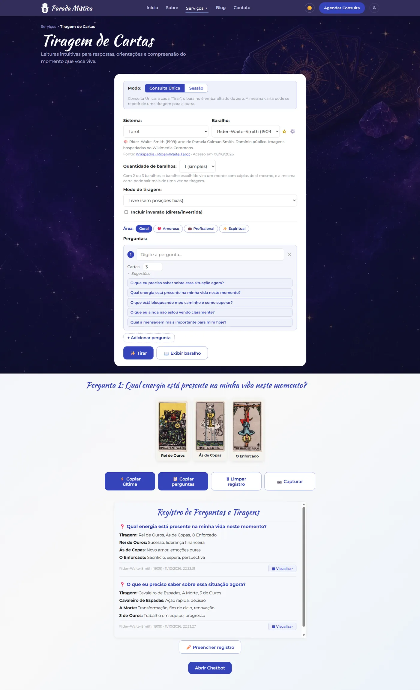
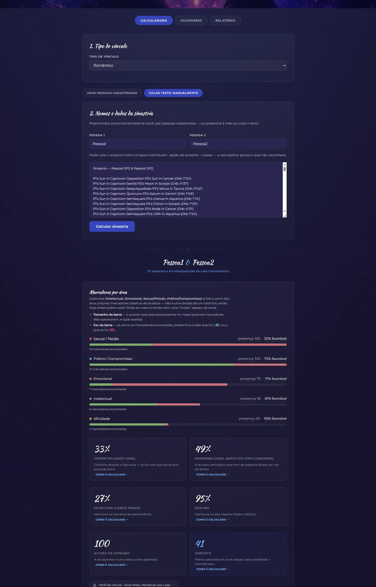
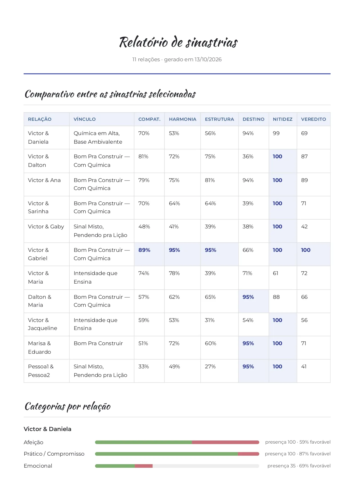
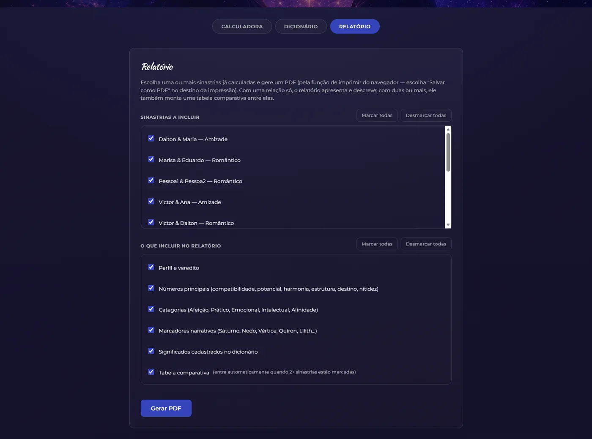
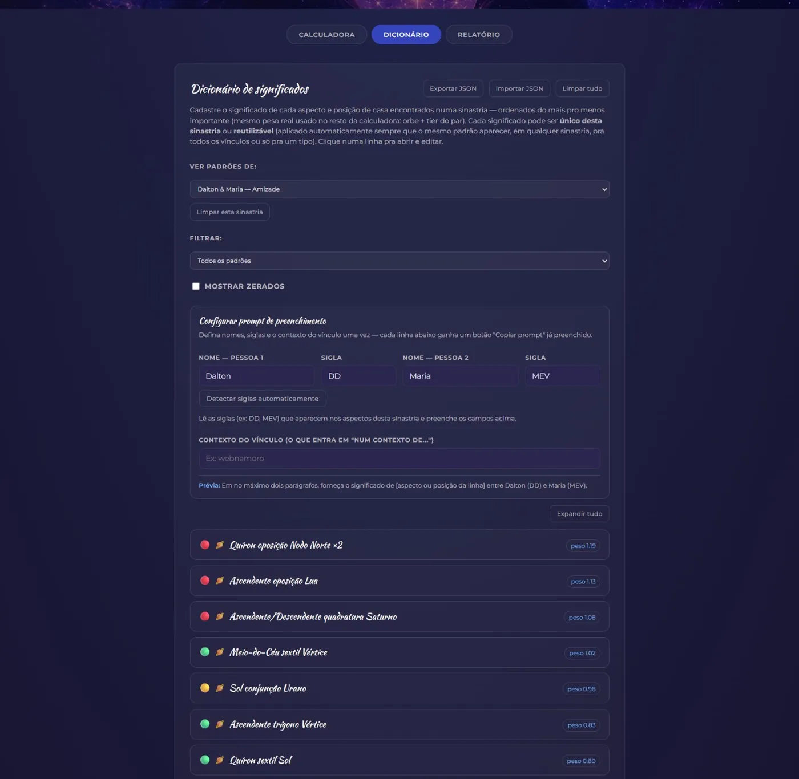
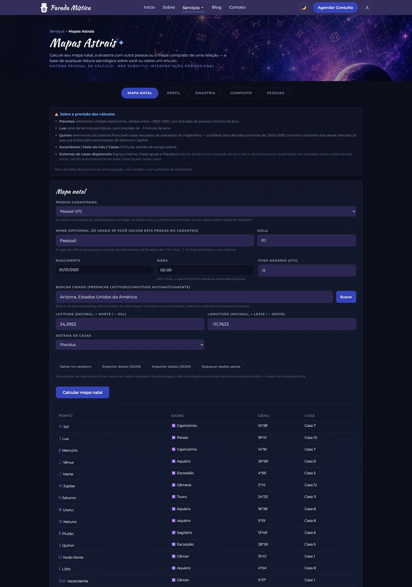
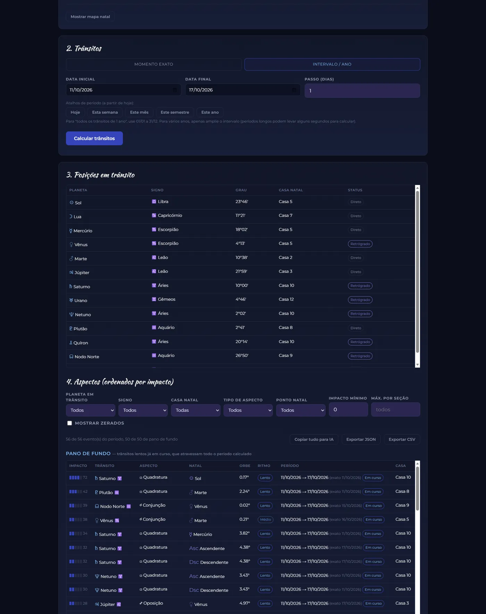

# Parada Mística: kit de astrologia e tarot

🇧🇷 Português (BR) · 🇬🇧 [Read in English](README.md)

> A versão oficial deste README é a em inglês ([README.md](README.md)). Este arquivo é a tradução de apoio.


Site em português que reúne quatro ferramentas de autoconhecimento sob uma só marca: **tiragem de cartas** (tarot e oráculos), **sinastria** com relatório em PDF, **mapas natal e composto** e **efemérides e trânsitos**. É um projeto pessoal que modela a presença de um atendimento profissional de astrologia, feito com HTML, CSS e JavaScript puros, sem framework e sem etapa de build.

## Funcionalidades

- **Tiragem de cartas (Cartarium).** Sistemas de Tarot, Lenormand, Sibilla, Kipper, oráculos e runas; de 1 a 3 baralhos embaralhados juntos; tiragens livres ou com posições fixas; cartas invertidas opcionais; perguntas sugeridas por área (geral, amoroso, profissional, espiritual); modos Consulta Única e Sessão; registro de perguntas e tiragens com os significados; copiar e capturar imagem.
- **Gerenciador de baralhos.** Importe, exporte, crie e exclua seus próprios baralhos no navegador, ou crie um sistema novo que reaproveita as tiragens de um existente. Veja [docs/custom-decks.md](docs/custom-decks.md) (em inglês).
- **Sinastria.** Calcula uma leitura da relação a partir dos aspectos e das sobreposições de casas de dois mapas: marcadores por área (afeição, prático, emocional, intelectual, afinidade, paixão), notas (compatibilidade, harmonia, estrutura, destino, nitidez, veredito), comparação entre várias relações, dicionário de significados editável e relatório em PDF para imprimir.
- **Mapas.** Mapa natal com planetas, ângulos, partes, dignidades, leitura estrutural e cadastro de pessoas; sinastria e mapa composto.
- **Efemérides e trânsitos.** Trânsitos individuais e duplos em um período, com tabela de aspectos ordenada por impacto. Os resultados podem ser copiados para uma IA ou exportados em Markdown, JSON ou CSV.
- **Temas claro e escuro** e layout responsivo.

## Capturas de tela

<p align="center">
  <picture>
    <source media="(prefers-color-scheme: dark)" srcset="docs/screenshots/home-dark.webp">
    
  </picture>
</p>

<p align="center">
  <picture>
    <source media="(prefers-color-scheme: dark)" srcset="docs/screenshots/card-reading-dark.webp">
    
  </picture>
</p>

<details>
<summary>Mais capturas</summary>

| Calculadora de sinastria | Relatório de sinastria (PDF) |
|---|---|
|  |  |

| Opções do relatório | Dicionário de significados |
|---|---|
|  |  |

| Mapa natal | Trânsitos |
|---|---|
|  |  |

As imagens seguem o tema do seu GitHub; o site tem seu próprio botão de tema claro e escuro. Os nomes nos exemplos são primeiros nomes de pessoas que concordaram em aparecer.

</details>

## Tecnologias

- HTML, CSS e JavaScript puro (módulos ES nas páginas de mapas e efemérides). Sem framework, sem bundler.
- Dados salvos só no navegador: `localStorage` para pessoas e preferências, `IndexedDB` para baralhos personalizados.
- [html2canvas](https://html2canvas.hertzen.com/) (CDN) para capturar imagem, [Nominatim](https://nominatim.org/) (OpenStreetMap) para buscar cidades, Google Fonts (Montserrat) e uma cópia local da Kaushan Script nos títulos.
- Hospedagem estática, com um `netlify.toml` pronto.

## Como rodar

Não há nada para instalar. Sirva a pasta com qualquer servidor estático (abrir `index.html` direto por `file://` quebra os módulos ES e o IndexedDB):

```bash
# Python
python3 -m http.server 8000

# ou Node
npx serve .
```

Depois abra `http://localhost:8000`.

Para publicar, conecte o repositório ao Netlify (ou a qualquer hospedagem estática). O `netlify.toml` já define que não há comando de build e que a raiz do projeto é publicada.

## Estrutura do projeto

```
├── index.html               Página inicial
├── tiragem-cartas.html      Tiragem de cartas (Cartarium)
├── sinastria.html           Sinastria: calculadora, dicionário, relatório
├── mapas.html               Mapas natal, composto e pessoas
├── efemerides.html          Trânsitos e efemérides
├── style.css                Página inicial e estrutura comum (cabeçalho, menu, rodapé)
├── netlify.toml             Configuração da hospedagem estática
├── assets/
│   ├── css/tokens.css       Tokens de design (cores, tipografia, espaçamento)
│   ├── fonts/               Kaushan Script (OFL)
│   ├── js/                  Scripts compartilhados, como o seletor de pessoas
│   └── backgrounds/, *.png  Imagens de fundo e marcas
├── js/                      Estrutura comum e lógica do Cartarium
│   ├── custom-decks.js      Gerenciador de baralhos (importar, exportar, criar, excluir)
│   └── main.js, spreads.js, systems.js, loader.js, ...
├── decks/                   Definição dos baralhos (riderwaite.js, _template.js)
├── images/riderwaite/       Imagens das cartas (digitalizações de 1909, domínio público)
├── sinastria/               CSS e lógica das páginas de sinastria
├── efemerides/              CSS e lógica das páginas de mapas e efemérides
├── docs/                    Documentação, capturas de tela e um baralho de exemplo
└── scripts/                 Script auxiliar para preparar imagens de cartas
```

## Escopo e limitações

- **Entretenimento e reflexão, não aconselhamento.** As leituras e as notas de sinastria vêm de pesos heurísticos sobre planetas, aspectos e casas. Não têm base científica e não substituem orientação profissional. As páginas avisam isso.
- **Precisão astronômica.** Os planetas usam elementos orbitais keplerianos válidos aproximadamente de 1900 a 2100, com precisão de poucos minutos de arco. A Lua usa uma série de termos periódicos (cerca de 1 minuto de arco). Quíron usa elementos osculadores fixos, confiáveis para décadas em torno de 2000 a 2050. Casas: Signos Inteiros, Casas Iguais e Placidus (o Placidus pode falhar em latitudes muito altas). Em casos de fronteira, confira em um software de astrologia dedicado.
- **Conteúdo de exemplo.** Os depoimentos, o contador "+1.200 pessoas", o botão de agendamento, o formulário de newsletter, o ícone de login e as páginas Sobre, Blog e Contato são provisórios. Nada é salvo nem enviado.
- **Privacidade.** Dados de nascimento e pessoas ficam no seu navegador. Digitar uma cidade envia esse texto ao Nominatim, e as páginas carregam Google Fonts e html2canvas de servidores externos.
- **Chatbot.** A página de tiragem incorpora um chatbot de terceiros (ThinkStack). Se você fizer um fork, troque o `chatbot_id` em `tiragem-cartas.html` pelo seu ou remova o iframe.
- **Um baralho de fábrica.** Esta edição pública traz só o Rider–Waite–Smith (1909), que é domínio público, e uma fonte livre. A versão pessoal original usava uma fonte comercial e vários baralhos cuja arte não podia ser redistribuída, o que forçou essas escolhas. Use o gerenciador de baralhos para adicionar os seus.
- **Feito com apoio de IA.** As imagens de fundo foram geradas com o ChatGPT e editadas pelo autor, e os textos de significado das cartas foram escritos pelo autor com apoio de IA generativa.

## Licença

O código-fonte está sob a [Licença MIT](LICENSE). As imagens, a fonte e a arte das cartas têm termos próprios, listados em [NOTICE.md](NOTICE.md).
